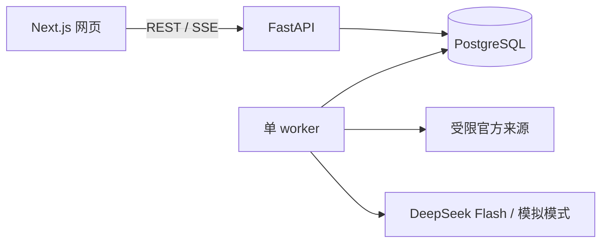

# TechLedger 详细介绍与面试讲解

更新：2026-10-29。仓库：[David-Chen31/TechLedger](https://github.com/David-Chen31/TechLedger)。本文件描述已实现的原型；目标设计见 [PRD](../PRD.md)。

## 产品问题与定位

技术选型讨论后，团队常难以追溯结论依赖哪份资料、哪个版本，也难判断资料更新后哪些决策需要复核。TechLedger 把**官方来源审核、可打开的引用、模型草稿、人工批准、来源变化提醒**串成一个流程。首个演示领域是 Python Agent 编排框架，仅使用 LangGraph 和 CrewAI 的公开官方文档。当前是本地单用户原型，尚无团队长期使用数据。

它与 DevFlow-Agent 分工不同：DevFlow-Agent 处理 Issue、代码定位和补丁；TechLedger 处理技术资料与决策依据。

## 用户流程

1. **登记并审核来源**：限定可登记 URL；先保存快照元数据，人工确认用途后才允许本地正文索引。
2. **检索并核对**：搜索已批准资料，查看来源 URL、快照哈希和固定原文片段。可对照 BM25、字符 n-gram TF-IDF 和 RRF 融合；实际调研默认 BM25。
3. **运行调研**：输入问题、硬约束和最多三个候选。Python 规划器识别有限能力维度，按候选来源检索，发现词面缺口时最多补查六次。最多六条证据，每条送入模型不超过 220 字符；模型只做一次简短总结。查询、命中、缺口、停止原因和可得 Token 用量进入运行轨迹。
4. **审查决策卡**：打开固定快照核对后批准、修订或退回。程序标记为已核验的 `claims` 仅是与原文逐字对应的摘录；模型摘要仍需人审。
5. **来源变化复核**：新快照和索引变化会标记关联卡片待复核，不会自动宣告旧结论错误。

## 实际架构

Docker Compose 运行数据库、API、worker 和网页。API 创建任务与查询结果，worker 负责同步和调研，事件落库后由 SSE 展示。当前**没有** LangGraph 运行时、Qdrant、语义 embedding、模型自主工具循环或多 Agent 协作。密钥保存在被 Git 忽略的本地文件，仅挂载给 worker。真实模型审核记录见[模型记录](model-review-v0.1.md)。

## 工程取舍

| 设计 | 原因与限制 |
|---|---|
| 来源先审核后索引 | 避免未经审核网页直接进入模型；首次使用步骤较多 |
| 快照哈希和固定引用 | 可复核、可冻结评测；来源更新需要重新确认 |
| 有界检索、单轮模型 | 控制调用量和输入规模；不能处理开放式多步研究 |
| 原文摘录与摘要分开 | 摘录可逐字验证；摘要仍可能错误 |
| BM25 为调研默认模式 | 早期种子题里本地字符向量未改善负例拒答；跨语义表达仍会漏检 |
| 展示失败和未知项 | 不把缺证据写成确定结论；词面覆盖判定仍可能误判 |

## 评测与失败案例

开发种子题用于调试，不算未见数据。一次六道新问法验证绑定两份已批准来源和索引哈希，使用相同 BM25 与 220 字符输入上限：旧规划的目标证据输入覆盖为 **1/6**，当前规划为 **5/6**。流式 2/2、长期记忆 2/2、Crew 协作 1/2。剩余 Crew 题召回了正确引用块，但目标句不在发送给模型的片段里。原始题目、逐题结果和方法见[验证报告](capability-independent-validation-v0.1.md)。

该指标只说明预标注短语是否进入模型输入，**不是回答准确率、决策正确率或用户节省时间**。题目由开发者编写，只有两份来源，尚无外部标注。一次针对片段排序的修改没有改善失败题，已撤回，不能把它当成已解决问题。

## 运行与演示

根目录执行 `docker compose up -d --build --wait`，打开 `http://localhost:3100`；API 健康检查为 `http://localhost:8000/health`。无模型密钥时为模拟模式；真实模式配置见 [README](../README.md)。按[五分钟脚本](demo-runbook.md)展示来源审核、证据引用、调研轨迹、卡片退回和失败题。录屏时隐藏密钥和本地环境配置，明确区分历史真实调用与当场模拟运行。

验证入口：设置 `PYTHONPATH=backend` 后运行 `python -m pytest backend/tests -q`；前端执行 `npm run build --prefix frontend`；启动 Compose 后执行 `npm run test:e2e --prefix frontend`。GitHub Actions 覆盖后端、前端、Compose 和浏览器测试。真实用户试用方案见[试用模板](user-study-kit.md)，目前尚未执行。

## 面试讲法

**30 秒版**：我开发了 TechLedger，将技术选型从一次模型回答变成可追溯的证据流程。系统先审核官方来源，再检索固定快照，生成带引用的待审草稿；人可以修订或退回，来源变化会提醒复核。FastAPI、Next.js、PostgreSQL、Docker 和 DeepSeek API 构成完整链路，并有冻结题集和 CI。

**Agent 在哪里？** 规划、工具检索、词面缺口检查和一次补查由确定性代码控制，模型负责归纳；每次调用及停止原因可见。它是有界 Agent 应用原型，不是模型自主规划的多 Agent 系统。

**效果如何？** 六道新问法中，目标证据进入输入从 1/6 到 5/6，但一题仍在片段截取时失败。只能说明这组小样本检索输入改善，不能推断用户价值；下一步需外部开发者用真实任务检验。

**简历表述**：TechLedger｜可审查的 AI 技术决策原型。基于 FastAPI、Next.js、PostgreSQL、Docker 与 DeepSeek API，实现来源快照、固定引用、有界证据检索、人工复核及运行轨迹；建立冻结题集与 GitHub CI。六道新问法中目标证据输入覆盖由 1/6 增至 5/6，并保留失败案例。切勿改写为“决策准确率提升”。
